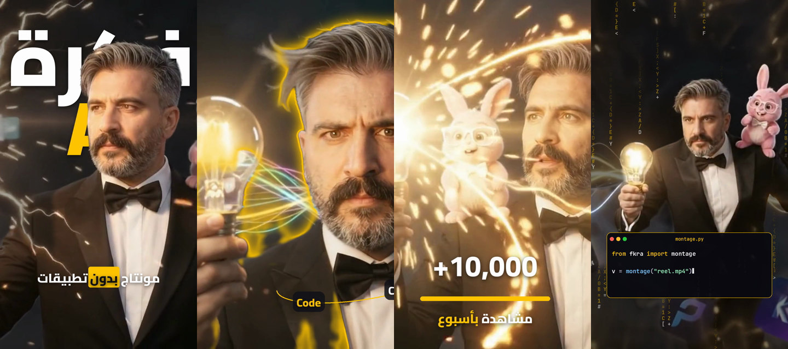

<div align="center">

# 🎬 FKRA Depth Studio

### مونتاج طبقات احترافي حوالين الشخص — بلا CapCut، بلا Descript، بلا After Effects

**نص خلف الشخص · أمام الشخص · فوق راسه · كلمات بتلف حواليه · أرقام بتتحرك · كود · تفاعل مع الإيد والصوت**

صُنع بواسطة **عامر الخطيب — Amer Khatib** · [FKRA AI](https://github.com/Khatibamer)



</div>

---

## ✨ شو هو؟

**FKRA Depth Studio** هو محرّك مونتاج بيشتغل من التيرمينال، وفوقه مجموعة **Claude Skills** بتخلّي
Claude يعملك مونتاج "عمق" على أي فيديو لشخص عم يحكي:

1. بيقصّ الشخص من الخلفية **بكل فريم** (matte).
2. بيلاحق **الوجه، أعلى الراس، الإيدين، وعلوّ الصوت**.
3. بيركّب التصاميم بطبقات: `الخلفية ← خلف الشخص ← 👤 الشخص ← قدّام الشخص ← الكاميرا`.

كل شي بيصير **على جهازك**. الفيديو ما بيطلع لأي سيرفر.

## 🎨 التصاميم

| السكيل | شو بيعمل |
|---|---|
| `fkra-text-behind-person` | كلمة ضخمة ورا الراس، دائرة ورا الشخص، نص مفرّغ ومتدرّج، ظلال بتلحق الشخص |
| `fkra-text-front-person` | كلمات بتفرقع مع الكلام، هايلايت، بطاقات عناوين، سكرينشوت عائم |
| `fkra-text-above-head` | عنوان فوق الراس بيلحقه، إطار على الوجه، سهم للوجه |
| `fkra-orbit-around-person` | كلمات ولوغوهات بتلف حوالين الشخص (من وراه ومن قدّامه)، نيون حوالين الجسم |
| `fkra-code-motion` | كود بينكتب لحاله، تيرمينال، كود نازل ورا الشخص |
| `fkra-number-motion` | عدّاد أرقام، نسب مع شريط، أرقام عربية ١٢٣، رقم ضخم ورا الشخص |
| `fkra-motion-graphics` | أسهم، انفجارات، جريد، جزيئات، تغيير الخلفية، زوم على الوجه، اهتزاز، فلاش |
| `fkra-interactive-motion` | كرة ضو على رأس الإصبع، فرقعة بالأصابع، نبض مع الصوت، عمق مع حركة الراس |
| `fkra-depth-montage` | المحرّك: `analyze` · `preview` · `render` + مرجع كل الإعدادات |

## 🚀 التشغيل

```bash
pip install numpy pillow opencv-python-headless mediapipe     # + ffmpeg
E=skills/fkra-depth-montage/scripts/depthfx.py
python3 $E analyze video.mp4 work/        # قصّ الشخص + التتبّع (مرة وحدة)
python3 $E preview plan.json 1.5 4 7      # صور معاينة + فحص إذا الشخص مغطّي النص
python3 $E render plan.json               # الفيديو النهائي مع الصوت
```

مع Claude Code: انسخ مجلد `skills/` إلى `.claude/skills/` في مشروعك، وقلّه:
**"اعملي مونتاج لهالفيديو"**. رح يختار التصاميم اللي بتناسب فكرة الفيديو لحاله.

مثال `plan.json`:
```json
{
  "video": "cut.mp4", "work": "work", "out": "final.mp4",
  "layers": [
    {"type": "text", "text": "فكرة\n*AI*", "fit": 0.95, "z": "behind", "pos": [0.5, 0.2], "start": 0, "end": 3, "in": "zoom"},
    {"type": "orbit", "items": ["Claude", "Code", "Video", "AI"], "start": 3, "end": 6},
    {"type": "counter", "from": 0, "to": 10000, "text": "+{n}", "pos": [0.5, 0.76], "start": 6, "end": 9}
  ]
}
```

## 🔒 الأمان

- بيشتغل محلياً 100%، بلا تتبّع وبلا مفاتيح API.
- كل ملف بينزل (موديلات وخطوط) مثبّت على نسخة محدّدة ومتحقَّق منه بـ SHA-256.
- للإبلاغ عن ثغرة: [SECURITY.md](SECURITY.md) (بشكل خاص، مش issue عام).

## ⚖️ الحقوق والترخيص

**© 2026 Amer Khatib (FKRA AI). جميع الحقوق محفوظة.** الكود **مفتوح للقراءة**، مش مفتوح المصدر:

- ✅ مسموح: تقرأه، تتعلّم منه، تستعمله لتعمل مونتاج لفيديوهاتك الشخصية وتنشرها.
- ❌ ممنوع بلا إذن مكتوب: تبيعه، تعيد نشره أو رفعه بمكان تاني، تنشر نسخة معدّلة، تدرّب عليه AI، أو تحطّه بكورس أو منتج مدفوع.

التفاصيل الكاملة في [LICENSE](LICENSE). لطلب استعمال تجاري افتح issue بعنوان **"License request"**.
كل فيديو بيطلع من المحرّك فيه توقيع `Made with FKRA Depth Studio by Amer Khatib`.

---

<div align="center">

**English:** FKRA Depth Studio is a local, layered motion-design engine plus Claude Skills: it cuts
the person out of every frame so typography, numbers, code and shapes can sit behind, in front of,
around and above them, reacting to hands and voice. Source-available, all rights reserved. See [LICENSE](LICENSE).

صُنع بـ ❤️ · **Amer Khatib · FKRA AI**

</div>
